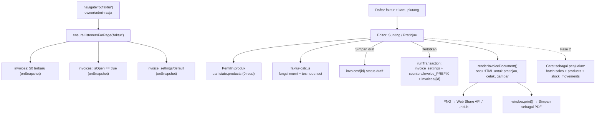

# Design Document: Faktur (Invoice) di ERP

Status: **disetujui, belum dieksekusi** (2026-11-05). Rujukan baris memakai `main` commit `1b0dcac`. Semua contoh angka dan nama **fiktif**.

## 1. Overview & Architecture



Ringkasan keputusan:
1. **Integrasi**: modul legacy terpisah (`public/legacy/faktur-calc.js` dan `public/legacy/faktur.js`) yang dimuat setelah `app-runtime.js`, bukan halaman React baru dan bukan tambahan ke dalam `app-runtime.js` (§7).
2. **Data**: satu dokumen per faktur dengan item di dalam array, satu dokumen pengaturan, satu dokumen counter. Tidak perlu index komposit (§3).
3. **Nomor**: counter doc yang dinaikkan di dalam `runTransaction` saat terbit. Draf belum bernomor (§4.1).
4. **Dokumen**: satu renderer HTML untuk pratinjau, cetak PDF, dan gambar PNG. Semuanya di browser, tanpa server (§6).
5. **Penjualan dan stok**: tidak disentuh di Fase 1; Fase 2 menambah "Catat sebagai penjualan" (§8).

## 2. Hasil survei kode

| Temuan | Bukti | Dampak ke desain |
|---|---|---|
| Belum ada kode faktur, PDF, atau share | `grep -niE "invoice\|faktur\|jspdf\|window.print\|wa.me"` di `app-runtime.js` hanya menemukan class badge WhatsApp (`:567`) | Fitur dibangun dari nol |
| Satu dokumen `sales` = satu produk | `saveSale`, `app-runtime.js:4547-4660` | Faktur multi-item tidak bisa dipetakan 1:1 ke satu `sales`. Fase 2 membuat satu `sales` per item |
| `txNumber` dihitung dari data lokal | `app-runtime.js:4593-4597` | Pola ini bisa bentrok. Faktur memakai counter + transaksi. Bug `txNumber` dicatat sebagai tindak lanjut terpisah (§11) |
| `saveSale` menulis stok, sales, dan stock_movements dalam 3 panggilan terpisah | `app-runtime.js:4606`, `:4639`, `:4644` | Fase 2 memakai satu `batch` supaya tidak setengah jadi |
| `resellers` hanya `{name, status, createdAt, updatedAt}` | `saveReseller`, `app-runtime.js:9163-9202` | Faktur menyimpan snapshot nama, kota, HP. Diskon default per reseller ditunda |
| Produk tanpa field varian atau satuan; foto `images[0].imageUrl` dari Cloudinary dengan transform `q_auto,f_auto,w_800` | `app-runtime.js:474`, `prodImg` `:384-389`, `saveNewProduct` `:2763-2810` | Varian dan satuan ditulis sebagai catatan item. Foto di faktur memakai transform lebih kecil |
| `state.products` dan `state.resellers` sudah dimuat saat login | `initFirebaseListeners`, `app-runtime.js:770-785`, `:860-871` | Pemilih produk dan reseller tidak menambah baca |
| Pola listener per halaman | `LAZY_LISTENERS`, `LAZY_LISTENERS_BY_PAGE`, `ensureListenersForPage`, `app-runtime.js:880-969`; reset di `cleanupAppSession` `:624-635` | Listener faktur didaftarkan ke objek yang sama |
| Cache offline aktif, dihapus saat logout | `app-runtime.js:35-37`, `:670-680` | Buka ulang halaman Faktur dalam 30 menit hanya membaca dokumen yang berubah |
| Peran owner/admin | `getCurrentUserRole` `:5394`, `updateNavigationAccess` `:722-743`, guard `navigateTo` `:1121-1130` | Menu dan guard Faktur mengikuti pola Reseller |
| Halaman yang dirender runtime memakai kontainer kosong | `#pageInvestor`, `src/components/InztamotoApp.jsx:711-713` | `#pageFaktur` dibuat dengan pola yang sama |
| Library dimuat dari CDN, berurutan | `src/components/LegacyScripts.jsx:51-56` | Modul faktur ditambahkan setelah `app-runtime.js` |
| `src/lib/firebase.js` tidak diimpor di mana pun | `grep -rn "lib/firebase" src` hanya menemukan file itu sendiri | Halaman React tidak punya akses Firestore yang siap pakai (§7) |
| Format uang Indonesia sudah ada | `fmtRp`, `app-runtime.js:255` (`Rp 1.320.000`) | Dipakai juga di dokumen faktur |
| Tema hanya terang | `src/app/globals.css` tidak punya `prefers-color-scheme` atau dark theme | Cek visual cukup tema terang |
| Rules Firestore tidak ada di repo | spec `firestore-read-quota` design §6 D-4 | Rules faktur diusulkan di §5, penerapannya tindakan produksi |

Bentuk data cukup diketahui dari kode, jadi database **tidak dibaca** untuk planning ini (kuota Spark tidak terpakai).

## 3. Model data Firestore

Konvensi mengikuti koleksi yang sudah ada: tanggal `YYYY-MM-DD` string, timestamp ISO string, uang Rupiah integer.

### 3.1 `invoices/{autoId}`

| Field | Tipe | Isi |
|---|---|---|
| `number` | string \| null | `INV0043`; `null` selama draf |
| `numberSeq` | int \| null | 43; dipakai rules dan pengurutan |
| `status` | string | `draft` / `issued` / `cancelled` |
| `paymentStatus` | string | `unpaid` / `partial` / `paid`, dihitung ulang setiap simpan |
| `isOpen` | bool | `status == issued && balanceDue > 0`; satu-satunya filter kueri piutang |
| `issueDate` | string | tanggal faktur |
| `dueDate` | string | jatuh tempo, ≥ `issueDate` |
| `customer` | map | `{ type: "retail" \| "reseller", resellerId, name, nameLower, city, phone }` |
| `items` | array of map | lihat §3.2, 1–50 item |
| `invoiceDiscount` | map | `{ type: "none" \| "percent" \| "amount", value }` |
| `tax` | map | `{ type: "none" \| "percent" \| "amount", value, label }` |
| `shippingFee` | int | ongkos kirim |
| `otherFee` | map | `{ label, amount }` |
| `subtotal`, `invoiceDiscountAmount`, `taxAmount`, `total` | int | hasil `faktur-calc.js`, disimpan agar daftar dan laporan tidak menghitung ulang |
| `paidAmount`, `balanceDue` | int | Fase 1 diisi langsung; Fase 2 = jumlah `payments` |
| `payments` | array of map | Fase 2: `{ id, date, amount, method, note, by, at }` |
| `paidAt`, `paidBy` | string, map | saat menjadi lunas |
| `notes` | string | catatan untuk pelanggan |
| `business` | map | snapshot saat terbit: `{ name, address, logoUrl, bankAccounts[], terms }` |
| `searchText` | string | huruf kecil: nomor, nama, kota, nama item; untuk cari lokal |
| `lastSharedAt` | string | terakhir dibagikan |
| `saleIds`, `salesRecordedAt`, `salesRecordedBy` | array, string, map | Fase 2 |
| `createdAt/By`, `updatedAt/By`, `issuedAt/By`, `cancelledAt/By`, `cancelReason` | | audit, pelaku `{ uid, name }` |
| `schemaVersion` | int | 1 |

### 3.2 Item (`items[]`)

| Field | Isi |
|---|---|
| `lineId` | id acak lokal, untuk urutan dan edit |
| `productId`, `sku` | kosong untuk item manual |
| `name`, `note` | nama tampilan dan catatan kecil ("sepasang") |
| `imageUrl` | URL Cloudinary versi kecil (§6.3); kosong untuk item manual |
| `qty` | int ≥ 1 |
| `catalogPrice` | `sellingPrice` saat item ditambahkan |
| `unitPrice` | harga satuan sebelum diskon item (bisa diedit) |
| `discount` | `{ type: "none" \| "percent" \| "amount", value }`; `amount` = potongan per unit |
| `unitDiscount`, `netUnitPrice`, `lineTotal` | hasil kalkulasi |

Ukuran: 50 item × sekitar 400 byte ≈ 20 KB per dokumen, jauh di bawah batas 1 MiB.

### 3.3 `invoice_settings/default`
`{ businessName, address, logoUrl, bankAccounts: [{ bank, number, holder }], terms, defaultDueDays: 7, numberPrefix: "INV", numberPad: 4, defaultTax: { type, value, label }, updatedAt, updatedBy }`

### 3.4 `counters/invoice_{PREFIX}`
`{ prefix: "INV", next: 101, lastInvoiceId, createdAt, createdBy, updatedAt }`. `next` adalah nomor yang akan dipakai faktur terbit berikutnya dengan prefix itu. Satu dokumen per prefix (keputusan Q-4, 2026-11-05): uji di produksi memakai `invoice_UJI`, faktur asli memakai `invoice_INV` yang mulai dari 101 (Q-2), sehingga uji tidak pernah memakan nomor `INV`.

Dokumen dibuat oleh form "Mulai penomoran" (Task 1.4) di dalam transaksi yang gagal bila dokumen sudah ada, jadi counter tidak pernah tertimpa. Faktur menyimpan `numberPrefix` di samping `number` dan `numberSeq`; keunikan berlaku per prefix.

Counter dipisah dari pengaturan supaya rules bisa membatasi perubahan counter hanya "+1" (§5), dan mengedit pengaturan tidak bersaing dengan penerbitan.

### 3.5 Kueri dan index

| Kueri | Dipakai untuk | Index |
|---|---|---|
| `invoices.orderBy("createdAt","desc").limit(50)` (listener) | daftar | otomatis (satu field) |
| `invoices.orderBy("createdAt","desc").startAfter(last).limit(50)` (`.get()`) | Muat lebih banyak | otomatis |
| `invoices.where("isOpen","==",true)` (listener) | kartu piutang, filter Belum dibayar/Sebagian/Lewat tempo | otomatis |
| `invoices.where("issueDate",">=",a).where("issueDate","<",b)` (`.get()`) | filter periode yang belum dimuat | otomatis |

Tidak ada kueri yang menggabungkan dua field berbeda, jadi **tidak perlu index komposit**. Filter status lain dan cari dikerjakan di memori pada faktur yang sudah dimuat.

### 3.6 Biaya baca

| Kejadian | Perkiraan read |
|---|---|
| Login tanpa membuka Faktur | 0 |
| Buka Faktur pertama kali | ≤ 50 + jumlah faktur terbuka + 1 pengaturan |
| Buka ulang dalam 30 menit (cache, `app-runtime.js:35`) | hanya dokumen yang berubah |
| Terbitkan | 2 read di transaksi (counter, pengaturan) |
| Muat lebih banyak | 50 per klik |

Perbandingan: membuka dasbor membaca sekitar 3.900 dokumen (spec `firestore-read-quota` §1.2). Dari faktur contoh `INV0009` bertanggal 26 Okt 2026, volume faktur diperkirakan puluhan per bulan (dugaan; perlu dicek ke owner), jadi biaya ini kecil.

## 4. Logika inti

### 4.1 Penomoran
```javascript
// Draft first, then issue: the number is taken only when the invoice becomes final, so abandoned drafts never leave gaps.
function issueInvoice(invoiceId, draft) {
   const settingsRef = db.collection("invoice_settings").doc("default");
   const invRef = invoiceId ? db.collection("invoices").doc(invoiceId) : db.collection("invoices").doc();
   return db.runTransaction(async (tx) => {
      const s = (await tx.get(settingsRef)).data();
      // One counter per prefix, so UJI test invoices never consume INV numbers.
      const counterRef = db.collection("counters").doc("invoice_" + s.numberPrefix);
      const counter = await tx.get(counterRef);
      if (!counter.exists) throw new Error("Penomoran " + s.numberPrefix + " belum dimulai");
      const seq = counter.data().next;
      tx.set(invRef, {
         ...draft,
         number: FakturCalc.formatInvoiceNumber(s.numberPrefix, seq, s.numberPad),
         numberPrefix: s.numberPrefix,
         numberSeq: seq,
         status: "issued",
         business: snapshotBusiness(s),
         issuedAt: nowIso(), issuedBy: actor(),
      });
      tx.update(counterRef, { next: seq + 1, lastInvoiceId: invRef.id, updatedAt: nowIso() });
      return invRef.id;
   });
}
```
- Transaksi Firestore dengan client SDK berjalan di Spark dan diulang otomatis bila counter berubah di tengah jalan. Inilah yang menjamin AC-2.
- Transaksi gagal saat offline. UI menampilkan "Butuh koneksi untuk menerbitkan" dan isian tetap tersimpan di draf lokal (NFR-2).
- `formatInvoiceNumber("INV", 43, 4)` → `INV0043`; `("INV", 10000, 4)` → `INV10000`.

### 4.2 `faktur-calc.js` (fungsi murni)
Tidak menyentuh DOM atau Firestore, sehingga bisa dites dengan `node --test` bawaan Node tanpa dependency.

```javascript
// Pure functions shared by the editor, the document renderer and the Fase 2 sales conversion.
var FakturCalc = (function () {
   function pct(base, percent) { return Math.round((base * percent) / 100); }
   function unitDiscount(item) { /* none | percent of unitPrice | amount, clamped to 0..unitPrice */ }
   function computeInvoice(inv) { /* returns { items, subtotal, invoiceDiscountAmount, taxAmount, total, balanceDue, paymentStatus, isOpen } */ }
   function formatInvoiceNumber(prefix, seq, pad) { return prefix + String(seq).padStart(pad, "0"); }
   function daysOverdue(dueDate, today) { /* whole days, 0 when not overdue */ }
   function allocateInvoiceDiscount(items, amount) { /* Fase 2: proportional split, largest remainder, sums exactly */ }
   return { pct, unitDiscount, computeInvoice, formatInvoiceNumber, daysOverdue, allocateInvoiceDiscount };
})();
if (typeof module !== "undefined") module.exports = FakturCalc;
```
Urutan hitung sesuai FR-5.2. Pembulatan memakai `Math.round` di setiap langkah persen (FR-5.3).

### 4.3 Contoh hitung (fiktif, juga dipakai sebagai kasus tes)

| Item | Harga | Diskon item | Harga bersih | Qty | Total baris |
|---|---|---|---|---|---|
| Tas samping contoh A | 300.000 | 10% (30.000) | 270.000 | 2 | 540.000 |
| Tas tangki contoh B | 150.000 | – | 150.000 | 3 | 450.000 |
| Jasa sablon (manual) | 25.000 | – | 25.000 | 1 | 25.000 |

- Subtotal 1.015.000. Diskon faktur 5% = 50.750. Dasar pajak 964.250.
- Kasus 1, pajak tidak ada: ongkir 30.000 → Total 994.250. Dibayar 500.000 → Saldo 494.250, status `partial`.
- Kasus 2, pajak 11%: `Math.round(964.250 × 0,11)` = 106.068 (dari 106.067,5) → Total 964.250 + 106.068 + 30.000 = 1.100.318.
- Kasus 3, batas: diskon item nominal 400.000 pada harga 300.000 dipotong menjadi 300.000 (harga bersih 0), tidak negatif.
- Kasus 4, nomor: `formatInvoiceNumber("INV", 9, 4)` = `INV0009`; `daysOverdue("2026-10-05", "2026-11-03")` = 29.

## 5. Rules Firestore (usulan, belum diterapkan)

Rules tidak ada di repo. Rules produksi dicek read-only lewat Firebase CLI pada 2026-11-05 dan isinya satu aturan: `match /{document=**} { allow read, write: if request.auth != null; }`. Fase 1 berjalan dengan rules itu (keputusan Q-3). Usulan di bawah hanya untuk koleksi faktur dan dijadwalkan di Task 3.5; untuk counter per prefix (§3.4), path `counters/invoices` di bawah dibaca sebagai `counters/invoice_$(prefix)` dengan prefix dari `request.resource.data.numberPrefix`. **Menerapkan rules adalah tindakan produksi dan butuh persetujuan Sehan.**

```
function isSignedIn() { return request.auth != null; }
// One extra document read per request; listeners evaluate it once per query, not per document.
function role() { return get(/databases/$(database)/documents/users/$(request.auth.uid)).data.role; }
function isInvoiceStaff() { return isSignedIn() && role() in ["owner", "admin", "Owner", "Admin"]; }

match /invoice_settings/{doc} {
  allow read, write: if isInvoiceStaff();
}
match /counters/invoices {
  allow read: if isInvoiceStaff();
  allow create: if false;  // dibuat sekali lewat Console atau skrip setup
  allow update: if isInvoiceStaff()
    && request.resource.data.next == resource.data.next + 1
    && getAfter(/databases/$(database)/documents/invoices/$(request.resource.data.lastInvoiceId)).data.numberSeq == resource.data.next;
}
match /invoices/{id} {
  allow read: if isInvoiceStaff();
  allow create: if isInvoiceStaff()
    && (request.resource.data.status == "draft"
        || getAfter(/databases/$(database)/documents/counters/invoices).data.next == request.resource.data.numberSeq + 1);
  allow update: if isInvoiceStaff()
    && (resource.data.numberSeq == null
        ? (request.resource.data.status == "draft"
           || getAfter(/databases/$(database)/documents/counters/invoices).data.next == request.resource.data.numberSeq + 1)
        : request.resource.data.numberSeq == resource.data.numberSeq && request.resource.data.number == resource.data.number);
  allow delete: if isInvoiceStaff() && resource.data.status == "draft";
}
```
Catatan risiko:
- Dokumen `users` bisa ber-ID email, bukan UID (`app-runtime.js:8914`, `:8955-8959`). Untuk pengguna seperti itu, `role()` gagal dan akses ditolak. Sebelum rules diterapkan, cek bahwa semua owner/admin punya dokumen `users/{uid}`. Bila tidak, pakai sementara `isSignedIn()` dan andalkan guard UI.
- Nilai `role` di data bisa berhuruf besar (`updateUserDisplay` menampilkan `u.role` apa adanya, `app-runtime.js:707`; `getCurrentUserRole` mengecilkannya, `:5395`), jadi rules menerima dua bentuk.

## 6. Dokumen faktur: pratinjau, gambar, PDF, dan bagikan

### 6.1 Satu renderer
`renderInvoiceDocument(invoice)` menghasilkan HTML dokumen dengan lebar desain 1080 px dan class prefix `inv-doc-` (supaya tidak bentrok dengan CSS ERP). HTML yang sama dipakai untuk:
- **Pratinjau** di layar, diperkecil dengan `transform: scale()` agar muat di lebar HP.
- **Cetak/PDF** lewat `window.print()`.
- **Gambar PNG** lewat salah satu opsi di §6.2.

Tata letak: dua kolom header (logo + nama bisnis | FAKTUR + nomor + tanggal), Tagih kepada, tabel item, lalu blok Info Pembayaran dan ringkasan, kemudian Syarat & Ketentuan. Kolom angka memakai `white-space: nowrap` dan `font-variant-numeric: tabular-nums` agar angka tidak terpotong seperti PDF lama. Cap LUNAS dan BATAL berupa teks miring bergaris tepi, bukan gambar.

### 6.2 Pembuatan PNG (keputusan Sehan, Q-1)

| Opsi | Cara | Kelebihan | Kekurangan |
|---|---|---|---|
| **A (usulan)** | `html2canvas@1.4.1` dari cdnjs, dimuat saat tombol Bagikan pertama kali ditekan, dengan pola `loadScript` di `LegacyScripts.jsx` | Satu sumber tata letak (HTML yang sama dengan pratinjau dan cetak) | Library pihak ketiga; hasil render CSS tidak 100% sama dengan browser, jadi CSS dokumen harus dijaga sederhana (tanpa grid kompleks, filter, atau `object-fit` yang tidak didukung) |
| B | Gambar manual dengan Canvas 2D (`fillText`, `drawImage`) | Tanpa library, kontrol penuh | Tata letak kedua yang harus selalu disamakan dengan HTML; lebih banyak kode |

Kedua opsi butuh gambar Cloudinary dimuat dengan CORS (`crossOrigin = "anonymous"`) agar canvas tidak "tainted". Header CORS Cloudinary **belum diverifikasi** untuk akun ini; diuji di Task 1.10 sebelum memilih.

### 6.3 Ukuran gambar
- URL foto item diubah dari transform `w_800` (`app-runtime.js:474`) ke `w_200` saat item ditambahkan, supaya gambar ringan.
- PNG diekspor dengan skala 1 pada lebar 1080 px. Faktur 50 item tingginya sekitar 1080 × 9.500 px (perkiraan); ini perlu diuji terhadap batas ukuran canvas di Chrome Android (risiko R-4). Bila terlalu besar, turunkan skala atau ekspor JPEG kualitas 0,9.

### 6.4 Bagikan
- **Gambar**: `navigator.canShare({ files: [file] })` lalu `navigator.share({ files: [file], title: number })`. Chrome mewajibkan `share()` dipanggil dekat dengan ketukan pengguna, sedangkan pembuatan gambar bisa makan beberapa detik. Karena itu alurnya dua langkah: tombol **Siapkan gambar** (membuat PNG), lalu tombol berubah menjadi **Bagikan** (memanggil `share()` langsung). Bila `canShare` tidak ada, file diunduh dengan nama `INV0043_2026-10-26.png`.
- **PDF**: `@media print` menyembunyikan seluruh ERP kecuali `.inv-doc`, `@page { size: A4; margin: 12mm }`, baris tabel `break-inside: avoid`. PDF berupa A4 (bisa beberapa halaman), bukan satu halaman panjang seperti aplikasi lama, karena dialog Cetak browser tidak mendukung ukuran halaman bebas.
- **Teks WhatsApp**: `https://wa.me/{62xxxxxxxx}?text=...` dibuka oleh pengguna sendiri; nomor HP diambil dari faktur dan dinormalisasi `08…` → `628…`. Tanpa nomor, memakai `https://wa.me/?text=...`.
- **Link publik** (Fase 3, opsional): `invoice_public/{token acak 24 karakter}` berisi snapshot dokumen tanpa data internal, rules `allow get: if true; allow list: if false;`, dan halaman `src/app/f/[token]/page.jsx` yang membacanya. Ini membuka data pembeli bagi siapa pun yang memegang link dan menambah read dari luar ERP, jadi hanya dibuat bila owner memintanya (Q-9).

## 7. Integrasi: modul legacy terpisah (rekomendasi)

| Opsi | Penilaian |
|---|---|
| Tambah langsung ke `app-runtime.js` | Paling sedikit kabel, tetapi file sudah 10.565 baris dan berbasis string HTML. Fitur sebesar ini (editor, picker, renderer, share) menambah ribuan baris ke file yang sama dan menyulitkan review. |
| Halaman React baru | UI editor mobile lebih nyaman ditulis di React. Tetapi semua state, navigasi, peran, dan koneksi Firestore ada di runtime global. `src/lib/firebase.js` tidak dipakai; memakainya berarti SDK Firebase kedua dari npm dengan instance Firestore kedua, yang bersaing dengan cache offline runtime (`app-runtime.js:35`) dan menambah baca. Menjembatani `navigateTo`, peran, dan `state.products` ke React juga butuh pekerjaan tambahan. |
| **Modul legacy terpisah (usulan)** | File baru `public/legacy/faktur-calc.js` dan `public/legacy/faktur.js`, dimuat oleh `LegacyScripts.jsx` setelah `app-runtime.js`. Script klasik berbagi deklarasi `const`/`function` tingkat atas, jadi modul ini bisa memakai `db`, `auth`, `state`, `fmtRp`, `toast`, `openModal`, `getCurrentUserRole`, `LAZY_LISTENERS`, dan `LAZY_LISTENERS_BY_PAGE` tanpa SDK kedua. `scripts/patch-runtime.cjs` hanya mengubah `app-runtime.js`, jadi tidak terpengaruh. |

Kabel yang tetap perlu ditambahkan ke `app-runtime.js` (kecil, tanpa mengubah ID/class yang ada):
1. `TITLES.faktur = "Faktur"` (`:1079-1096`).
2. `case "faktur"` di `renderCurrentPage()` yang memanggil `renderFaktur()` bila fungsinya ada (`typeof renderFaktur === "function"`), karena modul dimuat setelah runtime.
3. Guard peran di `navigateTo()` (pola `:1121-1130`) dan tampil/sembunyi `#menuFaktur` di `updateNavigationAccess()` (`:722-743`).
4. `cleanupAppSession()` (`:624-635`) memanggil `fakturCleanup()` bila ada, untuk mengosongkan state faktur. Listener faktur sendiri sudah ikut ditutup karena masuk `state.listeners` lewat `ensureListenersForPage`.

`faktur.js` mendaftarkan diri: `LAZY_LISTENERS.invoices_recent`, `LAZY_LISTENERS.invoices_open`, `LAZY_LISTENERS.invoice_settings`, dan `LAZY_LISTENERS_BY_PAGE.faktur = [...]`.

Markup di `InztamotoApp.jsx`: satu `nav-item` `data-page="faktur" id="menuFaktur"` di dekat Penjualan, dan kontainer kosong `<div className="page" id="pageFaktur">`. CSS faktur ditambahkan di `src/app/globals.css` dengan prefix `.fk-` (UI) dan `.inv-doc-` (dokumen).

Bila suatu saat ERP pindah ke React, `faktur-calc.js` bisa dipakai ulang apa adanya.

## 8. Fase 2: dari faktur ke penjualan

- **Catat sebagai penjualan** (FR-9.2) memakai satu `db.batch()`: untuk setiap item katalog, `sales.add` dengan field yang sama seperti `saveSale` (`app-runtime.js:4612-4638`) ditambah `invoiceId` dan `invoiceNumber`; `products.update` stok; `stock_movements.add`. Lalu `invoices.update` `saleIds` dan `salesRecordedAt`. Batch maksimal 500 operasi; 50 item × 3 + 1 masih aman.
- `realUnitPrice` = harga bersih setelah diskon item, dikurangi bagian diskon faktur dari `allocateInvoiceDiscount` dibagi qty. Bila hasil bagi tidak bulat, sisa dialokasikan per baris supaya jumlah `realRevenue` sama persis dengan subtotal − diskon faktur untuk item katalog (AC-10).
- `date` penjualan default = tanggal faktur, bisa diubah di dialog (Q-5).
- Bila spec `firestore-read-quota` Fase 4 (`sales_monthly`) sudah jalan saat Fase 2 dikerjakan, batch ini juga wajib menaikkan ringkasan bulanan.
- Riwayat pembayaran (`payments[]`) ditulis dalam transaksi yang membaca faktur, menambah item, lalu menghitung ulang `paidAmount`, `balanceDue`, `paymentStatus`, dan `isOpen`.

## 9. Arah UI (gaya ERP, mobile-first)

Prinsip: memakai token dan komponen ERP yang ada (`--primary` hitam `#1A1A1A`, font Plus Jakarta Sans, ikon Font Awesome, `.card`, `.stat-card`, `.form-input`, `.btn-primary`, `.badge`, `.action-btn`, `.empty-state`). Tidak meniru tema gelap atau warna biru aplikasi lama. Tanpa garis warna di sisi kartu dan tanpa garis dekoratif. Status ditunjukkan lewat badge teks.

### 9.1 Daftar faktur
- Atas: tiga `.stat-card` (Total piutang, Lewat jatuh tempo, Ditagih bulan ini). Di HP, ketiganya bisa digeser horizontal dalam satu baris.
- Baris chip filter yang bisa digeser, kotak cari, filter bulan/tahun, dan ikon pengaturan faktur (owner/admin).
- HP (< 768 px): kartu dengan baris 1 pelanggan + total, baris 2 nomor · tanggal, baris 3 badge status + keterangan ("Lewat 5 hari", "Lunas 26 Okt"). Tombol **+ Faktur** melayang di kanan bawah.
- Desktop: tabel (Nomor, Tanggal, Pelanggan, Total, Saldo, Jatuh tempo, Status, Aksi), dengan pagination seperti `investorPageSlice` (`app-runtime.js:9712`).

### 9.2 Editor
- Tampilan penuh di dalam `#pageFaktur`, bukan modal, karena modal ERP (`openModal`, `app-runtime.js:411-416`) terlalu sempit untuk 10+ item di HP.
- Atas: tombol kembali, nomor atau label DRAF, dan segmented **Sunting / Pratinjau**.
- Bagian berurutan: Pelanggan (saklar Reseller), Tanggal & jatuh tempo, Item, Ringkasan, Pembayaran, Catatan.
- Baris item ringkas: foto 40 px, nama + catatan, `qty × harga`, total, dan stepper qty. Ketuk baris membuka lembar edit item (nama, catatan, harga, diskon item, hapus).
- Ringkasan: Subtotal (baca saja), lalu baris Diskon, Pajak, Ongkir, Biaya lain yang bisa diketuk untuk mengisi. Total dan Saldo terutang tebal.
- Pembayaran: input Dibayar dengan format ribuan (`formatRpInput`, `app-runtime.js:300`) dan tombol **Tandai lunas**.
- Bar bawah menempel: **Simpan draf** (sekunder) dan **Terbitkan** (utama). Untuk faktur terbit: **Simpan** dan menu ⋯ (Batalkan, Catat sebagai penjualan di Fase 2).
- Keadaan sibuk ditampilkan dengan teks tombol ("Menerbitkan...") dan tombol nonaktif.

### 9.3 Pemilih produk
- Lembar dari bawah di HP, modal di desktop. Kotak cari otomatis fokus, daftar produk aktif dengan foto, nama, SKU, harga, dan stok.
- Ketuk produk untuk menambah item; ketuk lagi menambah qty. Ada tombol "Item manual".

### 9.4 Pratinjau dan bagikan
- Kertas putih dengan bayangan tipis, diperkecil agar muat layar. Bar aksi bawah: **Siapkan gambar / Bagikan**, **PDF**, **WhatsApp teks**, dan **Tandai lunas** bila belum lunas.

### 9.5 Pengaturan faktur
- Dibuka dari ikon di halaman Faktur, bukan di halaman Pengaturan yang sekarang berisi profil pengguna (`InztamotoApp.jsx:1016`).
- Form: logo (unggah Cloudinary, pola `handleImageUpload` di `app-runtime.js:432-495`), nama, alamat, daftar rekening (tambah/hapus), syarat, jatuh tempo default, prefix, pajak default. Nomor berikutnya tampil sebagai info baca saja.

Mockup visual belum dibuat. Usulan: setelah spec disetujui, buat mockup 3 layar utama (daftar, editor, pratinjau) di lebar 360 px untuk disetujui owner sebelum Task 1.6.

## 10. Perbandingan dengan aplikasi lama

| | Fitur |
|---|---|
| **Ditiru** | Daftar dengan filter status; editor Sunting/Pratinjau; Tagih kepada; tanggal dan jatuh tempo; tambah item dari katalog dengan cari; catatan kecil di bawah nama item; diskon persen atau nominal, per item atau total (V3); pajak persen atau nominal (V2); ongkir; biaya lain; Dibayar dan Saldo terutang; tandai lunas dengan waktu; cap LUNAS; keterangan "lewat jatuh tempo N hari"; info rekening; syarat 7 hari; foto produk di dokumen; bagikan dan cetak |
| **Dibuang** | Nomor yang bisa diedit (penyebab `INV0007` ganda); toggle lunas yang membuat saldo 0 walau dibayar 0; Nomor PO; kolom Satuan terpisah; pajak "Dipotong" dan "Per Barang"; Sesuaikan template/warna/font; e-mail; ikon Google Drive; tombol "Mar…" yang tidak terbaca; katalog item terpisah dan "simpan item untuk faktur berikutnya"; format tanggal dan uang gaya AS; garis warna di sisi kartu |
| **Ditambah** | Item tersambung ke katalog dan foto ERP; nomor otomatis tanpa bentrok lewat transaksi; draf tanpa nomor dan pembatalan yang menjaga urutan; label dan diskon reseller dari data `resellers`; harga asli dan persen diskon tercetak; share gambar PNG langsung ke WhatsApp; teks WhatsApp dengan ringkasan; kartu total piutang; audit siapa membuat, menerbitkan, melunasi, membatalkan; akses owner/admin; Fase 2 riwayat pembayaran dan catat sebagai penjualan; Fase 3 laporan piutang dan ekspor Excel |

## 11. Risiko

| ID | Risiko | Mitigasi |
|---|---|---|
| R-1 | Owner masih memakai aplikasi lama selama transisi, sehingga nomor bisa bentrok antar aplikasi | Nomor awal diset melewati nomor terakhir aplikasi lama (Task 0.4); tanggal pindah total disepakati (Q-2) |
| R-2 | Rules dengan `get(users/uid)` menolak admin yang dokumennya ber-ID email | Cek data `users` sebelum rules (Task 0.3); fallback `isSignedIn()` |
| R-3 | CORS Cloudinary atau html2canvas gagal menggambar foto, sehingga gambar kosong | Uji di Task 1.10; foto gagal diganti kotak kosong (FR-8.8); opsi B sebagai cadangan |
| R-4 | Canvas terlalu tinggi untuk faktur 50 item di HP | Uji 50 item di Chrome Android; turunkan skala atau pakai JPEG |
| R-5 | `navigator.share` ditolak karena aktivasi pengguna kedaluwarsa | Alur dua langkah Siapkan → Bagikan (§6.4) |
| R-6 | Uji manual menulis faktur ke database produksi (tidak ada staging, Q-4) | Prefix `UJI` dengan counter terpisah; faktur uji dibatalkan setelah uji; Fase 1 tidak menulis koleksi bisnis lain |
| R-7 | Fase 2 dobel hitung bila penjualan yang sama sudah dicatat manual di menu Penjualan | Peringatan di dialog; `invoiceId` di `sales` untuk pelacakan; keputusan alur kerja tim (Q-5) |
| R-8 | `txNumber` penjualan bisa bentrok (`app-runtime.js:4593-4597`), juga untuk penjualan dari faktur | Di luar spec ini; diusulkan sebagai perbaikan terpisah dengan counter yang sama polanya |
| R-9 | Draf lokal di `localStorage` tertinggal setelah logout di perangkat bersama | `fakturCleanup()` menghapus draf lokal saat logout, sejalan dengan `clearOfflineCacheAndReload` (`app-runtime.js:670-680`) |
| R-10 | Tanpa tes otomatis untuk UI, regresi di runtime tidak terdeteksi | Kalkulasi dan penomoran dites `node --test`; UI dicek manual dengan checklist per lebar layar |
